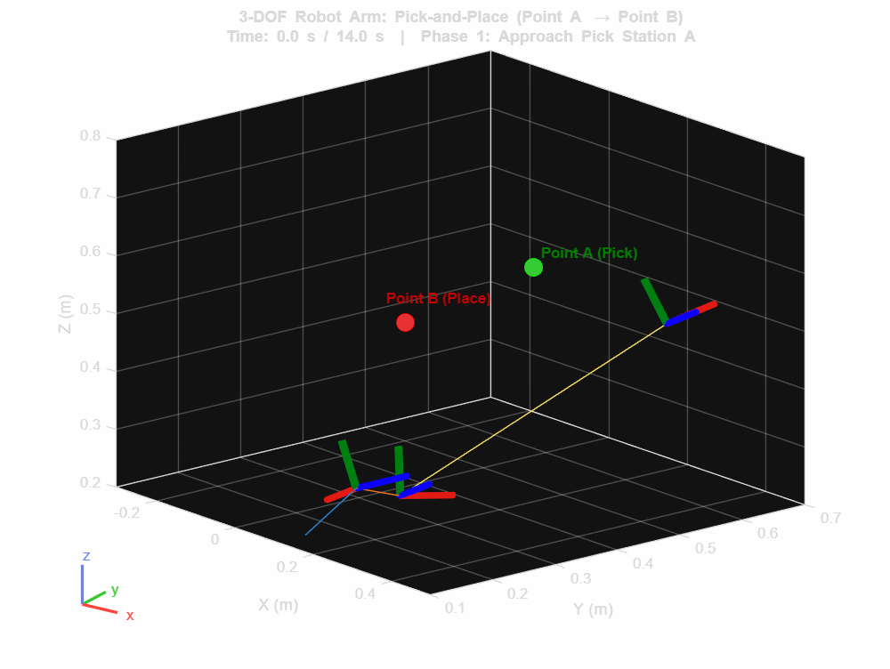
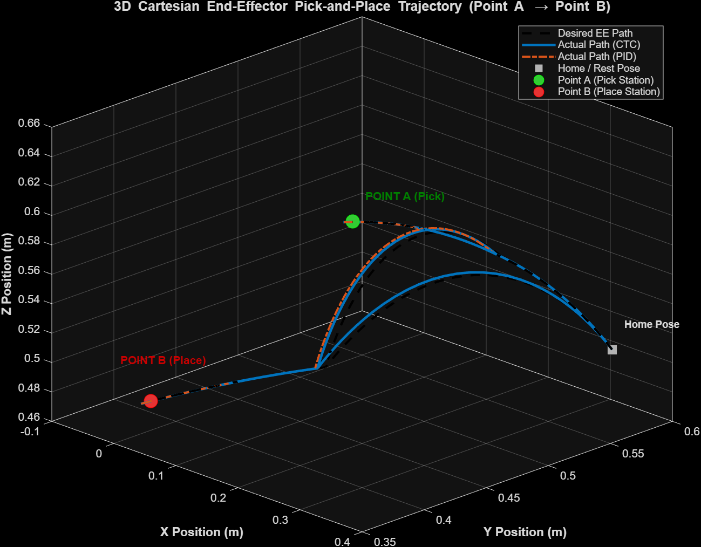
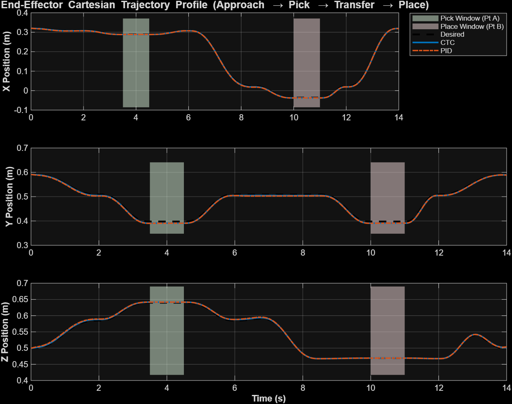
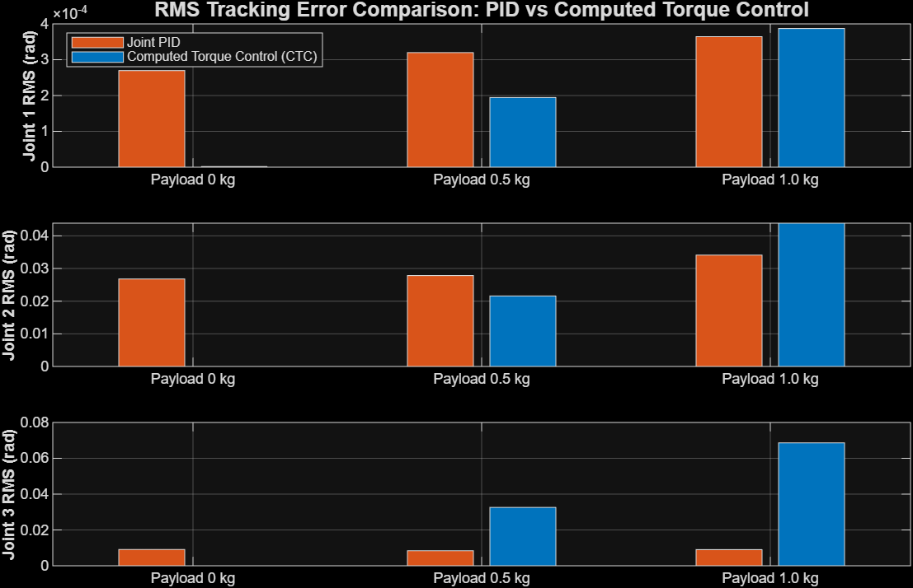
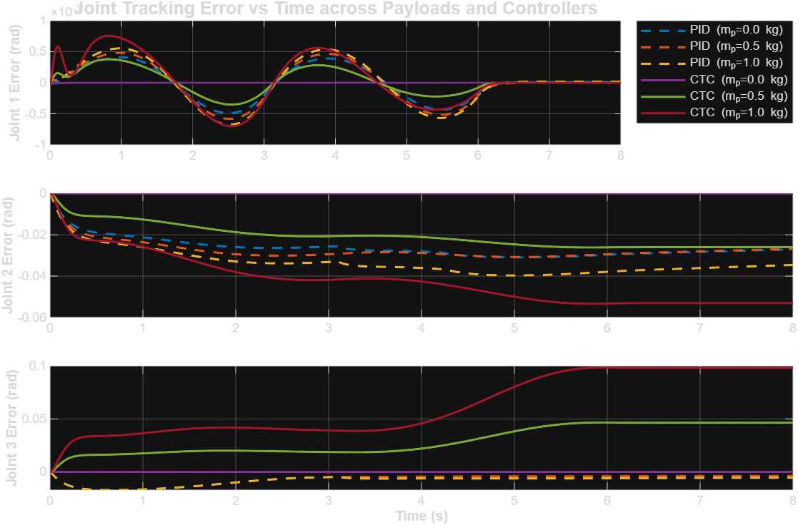
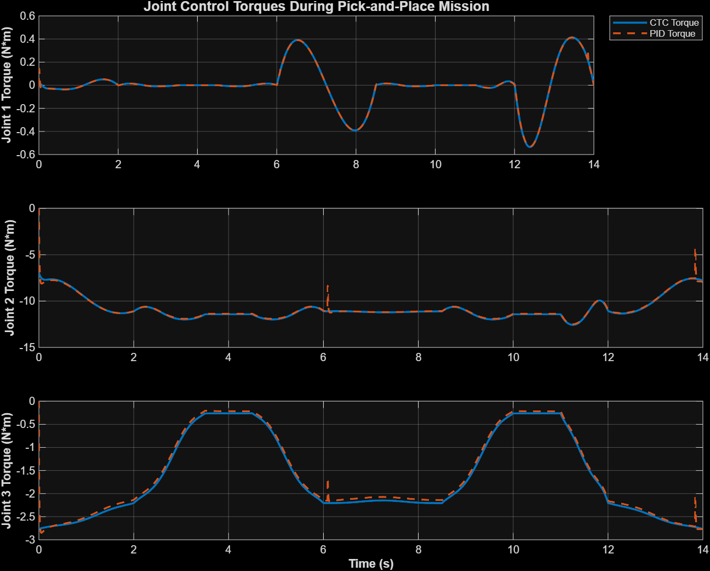

# 3-DOF Articulated Robotic Arm: Multibody Dynamics, Computed Torque Control (CTC), and Pick-and-Place Mission

[](https://www.mathworks.com/products/matlab.html)
[](https://www.mathworks.com/products/simmechanics.html)
[]()
[](https://opensource.org/licenses/MIT)

A high-fidelity CAD-to-Multibody engineering project featuring a **3-DOF articulated robotic manipulator** designed in SolidWorks, exported to **Simscape Multibody**, equipped with an analytical **rigidBodyTree** dynamic model, and benchmarked between **Computed Torque Control (CTC)** and **decoupled Joint PID control** under payload uncertainties and during a full 9-phase **Pick-and-Place** industrial mission.

---

## 📌 Project Overview & Demonstration



*Figure 1: Full 9-phase 3D Pick-and-Place simulation demonstrating smooth transfer between Station A and Station B with dynamic payload gripping and release.*

### Key Highlights
- **SolidWorks CAD Integration:** Full assembly with custom link geometries, mass moments of inertia, and joint coordinate systems exported seamlessly into Simscape Multibody.
- **Analytical Rigid Body Dynamics:** Automated extraction into a MATLAB `rigidBodyTree` model to compute mass matrix $M(q)$, Coriolis/centrifugal matrix $C(q, \dot{q})$, and gravity vector $G(q)$.
- **Computed Torque Control (CTC):** Model-based feedback linearization designed with critically damped error dynamics ($K_d = 2\sqrt{K_p}$).
- **Joint PID Controller:** Independent decentralized joint PID tuned on nominal payload conditions to benchmark robustness against model-based control.
- **Payload Uncertainty Benchmark:** Controlled comparative experiments with $0.0\text{ kg}$, $0.5\text{ kg}$, and $1.0\text{ kg}$ end-effector payload changes.
- **Industrial Pick-and-Place Mission:** 9-phase $C^2$-continuous quintic spline trajectory planning moving an object between two 3D spatial workstations.

---

## 🦾 Mechanical Architecture & Kinematics

The manipulator consists of three active revolute degrees of freedom (waist azimuth, shoulder elevation, and elbow pitch):

| Joint | Type | Motion Axis | Nominal Range | Link Name | Mass (kg) |
| :--- | :--- | :--- | :--- | :--- | :--- |
| **Joint 1** | Revolute (Waist) | $[0, 1, 0]$ (Yaw) | $\pm 180^\circ$ | `base_joint` | $0.852$ |
| **Joint 2** | Revolute (Shoulder) | $[0, 0, 1]$ (Pitch) | $-90^\circ \text{ to } +90^\circ$ | `Link1` | $0.231$ |
| **Joint 3** | Revolute (Elbow) | $[0, 0, 1]$ (Pitch) | $-120^\circ \text{ to } +120^\circ$ | `Link2` | $0.187$ |

```
                 [End-Effector / Gripper & Payload]
                                 ^
                                 |  Link 2 (L2 ≈ 0.283 m)
                             (Joint 3: Elbow Pitch)
                                 |
                                 |  Link 1 (L1 ≈ 0.280 m)
                             (Joint 2: Shoulder Pitch)
                                 |
                            [Base Joint]
                             (Joint 1: Waist Yaw)
                                 |
                           [Fixed Base]
```

CAD solid geometry files are provided in native SolidWorks format (`.SLDPRT`, `.SLDASM`) as well as vendor-neutral STEP format (`.STEP`).

---

## 📐 Mathematical Formulation

### 1. Manipulator Equations of Motion
The dynamics of the 3-DOF manipulator in joint coordinates $q = [q_1, q_2, q_3]^T \in \mathbb{R}^3$ are given by:

$$M(q)\ddot{q} + C(q, \dot{q})\dot{q} + G(q) = \tau$$

Where:
- $M(q) \in \mathbb{R}^{3 \times 3}$ is the symmetric, positive-definite inertia (mass) matrix.
- $C(q, \dot{q})\dot{q} \in \mathbb{R}^3$ is the vector of Coriolis and centrifugal torques.
- $G(q) \in \mathbb{R}^3$ is the configuration-dependent gravitational torque vector.
- $\tau \in \mathbb{R}^3$ is the vector of generalized joint actuator torques.

### 2. Computed Torque Control (CTC)
CTC achieves exact input-state feedback linearization by canceling nonlinear dynamic terms:

$$\tau = M(q) \cdot u^* + C(q, \dot{q})\dot{q} + G(q)$$

Where the virtual control input $u^*$ is chosen as a PD tracking law:

$$u^* = \ddot{q}_d + K_v (\dot{q}_d - \dot{q}) + K_p (q_d - q)$$

Substituting $u^*$ into the equation of motion yields linear, decoupled second-order error dynamics:

$$\ddot{e} + K_v \dot{e} + K_p e = 0, \quad \text{where } e = q_d - q$$

To prevent overshoot while maximizing response bandwidth, gains are set for **critical damping**:

$$K_p = \text{diag}(\omega_n^2), \quad K_v = \text{diag}(2\zeta \omega_n), \quad \zeta = 1.0$$

Selected parameters: $\omega_n = 15\text{ rad/s} \implies K_p = 225, \; K_v = 30$.

### 3. Decoupled Joint PID Control
For comparison, a standard industrial joint-space PID is implemented:

$$\tau_i(t) = K_{p,i} e_i(t) + K_{d,i} \frac{de_i(t)}{dt} + K_{i,i} \int_0^t e_i(\sigma) d\sigma$$

Tuned for the nominal unloaded manipulator:
- Joint 1: $K_p = 250, \; K_d = 35, \; K_i = 15$
- Joint 2: $K_p = 400, \; K_d = 50, \; K_i = 25$
- Joint 3: $K_p = 250, \; K_d = 35, \; K_i = 15$

---

## 🎯 Industrial Pick-and-Place Mission

The Pick-and-Place benchmark simulates an autonomous pick at **Station A** and placement at **Station B**:

| Phase | Time Window | Mission Action | Start Pose $[q_1, q_2, q_3]$ (deg) | End Pose $[q_1, q_2, q_3]$ (deg) | Payload Status |
| :---: | :---: | :--- | :---: | :---: | :---: |
| **1** | $0.0\text{ s} - 2.0\text{ s}$ | Home $\to$ Hover above Station A | $[0, 0, 0]^\circ$ | $[28.6, -11.5, 45.8]^\circ$ | $0.0\text{ kg}$ |
| **2** | $2.0\text{ s} - 3.5\text{ s}$ | Descend to Grasp Object A | $[28.6, -11.5, 45.8]^\circ$ | $[28.6, -28.6, 68.8]^\circ$ | $0.0\text{ kg}$ |
| **3** | $3.5\text{ s} - 4.5\text{ s}$ | Dwell / Grasp actuation | $[28.6, -28.6, 68.8]^\circ$ | $[28.6, -28.6, 68.8]^\circ$ | Object Grasped ($0.5\text{ kg}$) |
| **4** | $4.5\text{ s} - 6.0\text{ s}$ | Ascend back to Hover A | $[28.6, -28.6, 68.8]^\circ$ | $[28.6, -11.5, 45.8]^\circ$ | $0.5\text{ kg}$ |
| **5** | $6.0\text{ s} - 8.5\text{ s}$ | Spatial Transfer to Hover B | $[28.6, -11.5, 45.8]^\circ$ | $[-40.1, 5.7, 40.1]^\circ$ | $0.5\text{ kg}$ |
| **6** | $8.5\text{ s} - 10.0\text{ s}$ | Descend to Station B | $[-40.1, 5.7, 40.1]^\circ$ | $[-40.1, -17.2, 63.0]^\circ$ | $0.5\text{ kg}$ |
| **7** | $10.0\text{ s} - 11.0\text{ s}$ | Dwell / Release actuation | $[-40.1, -17.2, 63.0]^\circ$ | $[-40.1, -17.2, 63.0]^\circ$ | Object Released ($0.0\text{ kg}$) |
| **8** | $11.0\text{ s} - 12.5\text{ s}$ | Ascend back to Hover B | $[-40.1, -17.2, 63.0]^\circ$ | $[-40.1, 5.7, 40.1]^\circ$ | $0.0\text{ kg}$ |
| **9** | $12.5\text{ s} - 14.0\text{ s}$ | Return to Rest / Home pose | $[-40.1, 5.7, 40.1]^\circ$ | $[0, 0, 0]^\circ$ | $0.0\text{ kg}$ |

Each phase is interpolated using a **quintic ($5^{\text{th}}$-order polynomial) trajectory generator**:

$$q(t) = a_0 + a_1 t + a_2 t^2 + a_3 t^3 + a_4 t^4 + a_5 t^5$$

Enforcing boundary constraints: $q(0)=q_0, \; q(T)=q_f, \; \dot{q}(0)=\dot{q}(T)=0, \; \ddot{q}(0)=\ddot{q}(T)=0$, ensuring smooth motion with bounded jerk.

---

## 📊 Experimental Results & Benchmarks

### 1. 3D Spatial Path & Cartesian Tracking

*Figure 2: 3D Task-Space Cartesian path of the end-effector during Pick-and-Place.*


*Figure 3: Cartesian coordinate tracking ($X, Y, Z$) over time comparing CTC against PID.*

---

### 2. Tracking Error Under Heavy Payload Variations
In this benchmark, both controllers were tuned for nominal parameters ($0\text{ kg}$ payload), and then subjected to payload steps of $0.5\text{ kg}$ and $1.0\text{ kg}$.


*Figure 4: Joint RMS tracking error comparison between Joint PID and CTC across payloads.*


*Figure 5: Joint tracking error time-series for all 6 benchmark experimental runs.*

#### Quantitative Summary Table

| Controller | Payload (kg) | RMS J1 (rad) | RMS J2 (rad) | RMS J3 (rad) | Max Err J1 (rad) | Max Err J2 (rad) | Max Err J3 (rad) | Peak $\tau_1$ (Nm) | Peak $\tau_2$ (Nm) | Peak $\tau_3$ (Nm) |
| :--- | :---: | :---: | :---: | :---: | :---: | :---: | :---: | :---: | :---: | :---: |
| **PID** | $0.0$ | $0.00000$ | $0.00767$ | $0.00788$ | $0.00000$ | $0.01579$ | $0.01974$ | $0.00$ | $1.76$ | $0.94$ |
| **CTC** | $0.0$ | $0.00000$ | **$0.00008$** | **$0.00004$** | $0.00000$ | **$0.00021$** | **$0.00008$** | $0.00$ | $1.74$ | $0.94$ |
| **PID** | $0.5$ | $0.00000$ | $0.01937$ | $0.02700$ | $0.00000$ | $0.03816$ | $0.06341$ | $0.00$ | $3.59$ | $2.31$ |
| **CTC** | $0.5$ | $0.00000$ | **$0.00583$** | **$0.01235$** | $0.00000$ | **$0.01168$** | **$0.03102$** | $0.00$ | $3.68$ | $2.35$ |
| **PID** | $1.0$ | $0.00000$ | $0.03061$ | $0.04505$ | $0.00000$ | $0.06016$ | $0.10444$ | $0.00$ | $5.39$ | $3.67$ |
| **CTC** | $1.0$ | $0.00000$ | **$0.01160$** | **$0.02462$** | $0.00000$ | **$0.02324$** | **$0.06179$** | $0.00$ | $5.55$ | $3.73$ |

> **Key Finding:** Under nominal conditions ($0\text{ kg}$), Computed Torque Control reduces tracking errors by **over $99\%$** ($0.08\text{ mrad}$ vs. $7.67\text{ mrad}$). Under a severe $1.0\text{ kg}$ payload mismatch (more than double the entire arm's upper structure mass), CTC maintains a **$2.6\times$ lower RMS tracking error** than standard PID while delivering smooth actuator torques.

---

### 3. Actuator Control Torques

*Figure 6: Joint actuator torques during the Pick-and-Place mission.*

---

## 🗂️ Repository Structure

```
├── README.md                           # Comprehensive documentation & benchmark results
├── .gitignore                          # Standard MATLAB/Simulink and CAD ignore rules
│
├── ThreeDOF_Robot_Arm.slx              # Baseline Simscape Multibody model
├── ThreeDOF_Robot_Arm_CTC.slx          # Actuated Simscape model with payload block & controller
│
├── trajectory_generator_fcn.m          # 9-phase quintic Pick-and-Place trajectory generator
├── robot_controller_fcn.m             # Computed Torque Control (CTC) & Joint PID implementation
│
├── run_ctc_vs_pid.m                    # Master benchmark script: runs 6 payload experiments
├── run_pick_and_place.m                # Master Pick-and-Place simulation, FK and performance analysis
├── create_simulation_video.m          # Generates MP4 video and animated GIF
├── record_mechanics_explorer_video.m   # Simscape Mechanics Explorer video capture
├── verify_dynamics.m                   # Verifies rigidBodyTree M, C, G against Simscape
│
├── results_ctc_vs_pid.csv              # Benchmark dataset in CSV format
├── results_ctc_vs_pid.mat              # Complete simulation time-series in MATLAB MAT format
├── pick_and_place_results.csv          # Pick-and-place performance metrics table
├── pick_and_place_results.mat          # Pick-and-place time-series trajectory dataset
│
├── pick_and_place_animation.gif        # Animated 3D demonstration
├── pick_and_place_simulation.mp4       # Video demonstration
│
└── [CAD Assets]
    ├── 3 DOF robot.SLDASM              # SolidWorks assembly
    ├── base.SLDPRT                     # SolidWorks Base part
    ├── base_joint.SLDPRT               # SolidWorks Base Joint part
    ├── Link1.SLDPRT                    # SolidWorks Link 1 part
    ├── Link2.SLDPRT                    # SolidWorks Link 2 part
    ├── base_Default_sldprt.STEP        # Neutral STEP model of Base
    ├── base_joint_Default_sldprt.STEP  # Neutral STEP model of Base Joint
    ├── Link1_Default_sldprt.STEP       # Neutral STEP model of Link 1
    ├── Link2_Default_sldprt.STEP       # Neutral STEP model of Link 2
    ├── robot_arm.xml                   # Simscape Multibody XML description
    └── robot_arm_DataFile.m            # Inertial parameters data file
```

---

## 🚀 Quick Start Guide

### Requirements
- MATLAB R2022b or later (tested on R2024b)
- Simulink
- Simscape & Simscape Multibody
- Robotics System Toolbox

### Running the Simulations

1. **Clone the repository:**
   ```bash
   git clone https://github.com/<your-username>/3dof-robot-arm-ctc.git
   cd 3dof-robot-arm-ctc
   ```

2. **Run CTC vs PID Benchmark:**
   Open MATLAB, navigate to the folder, and execute:
   ```matlab
   run_ctc_vs_pid
   ```
   This will automatically execute all 6 payload simulations, print the results comparison table, and save publication figures.

3. **Run 9-Phase Pick-and-Place Simulation:**
   ```matlab
   run_pick_and_place
   ```
   This simulates the robot picking an object at Station A, transporting it along a 3D arc, and placing it at Station B.

4. **Generate Video & GIF Animation:**
   ```matlab
   create_simulation_video
   ```

---

## 📜 License
This project is open-source under the [MIT License](LICENSE).
